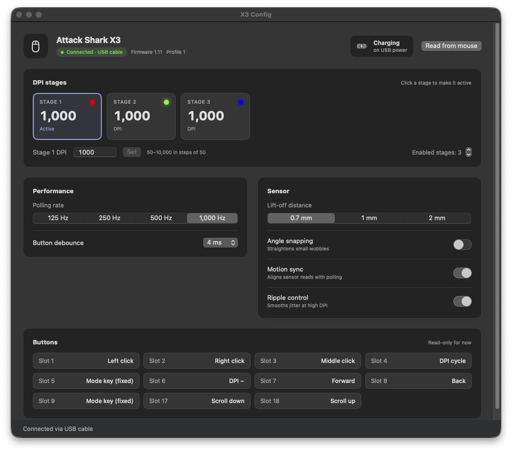

# attackshark-x3-mac

A native macOS configurator for the Attack Shark X3, since the vendor's driver is Windows-only.
It includes a SwiftUI app (`X3 Config.app`) and a command-line tool (`x3ctl`), both built on IOKit `IOHIDDevice`.
The app needs no kernel extension and no helper daemon.



## Setup

Download `X3-Config.zip` from [Releases](../../releases), unzip it and move **X3 Config** to Applications.
The app is ad-hoc signed rather than notarized, so the first launch needs right-click › **Open** › **Open**,
or `xattr -dr com.apple.quarantine "/Applications/X3 Config.app"`.

To build it yourself:

You need macOS 14 or later and the Xcode command-line tools (Swift 6).

```sh
./scripts/bundle.sh          # builds dist/X3 Config.app and dist/x3ctl
open "dist/X3 Config.app"
dist/x3ctl info
```

macOS may ask for **Input Monitoring** the first time. The prompt goes to the app that launched the tool
(Terminal for `x3ctl`). During testing, the receiver opened without a prompt.

For day-to-day use, run `swift build` and then `.build/debug/x3ctl …`.

## What works

Every change is read back from the mouse after it is written. The value shown is what the mouse holds,
not what the app sent.

| Setting | Read | Change | Notes |
|---|---|---|---|
| Polling rate | ✅ | ✅ 125 / 250 / 500 / 1000 Hz | Verified on hardware (1000 → 500 → 1000) |
| Active DPI stage | ✅ | ✅ | Verified (2 → 3 → 2) |
| Number of DPI stages | ✅ | ✅ | |
| DPI value of each stage | ✅ | ✅ 50–10,000 in steps of 50 | Stage 3 set 1000 → 2000 → 1000 and read back. Physical DPI was measured only at 1000, see below |
| Lift-off distance | ✅ | ✅ 1 / 2 / 0.7 mm | Codes from the X11 family; the mouse stores them, but the physical effect is not measured |
| Angle snapping, motion sync, ripple control | ✅ | ✅ | |
| Debounce (key response) | ✅ | ✅ 4–50 ms | Verified (4 → 6 → 4) |
| Sleep / deep-sleep timers | ✅ | — | |
| Button assignments | ✅ | 🚫 | Firmware reorders and write-protects slots; needs a mapping scan |
| Battery | ✅ | — | From the mouse's own status events, which arrive every few seconds |
| RGB | — | — | The X3 has no RGB lighting. Report 0x05 stores colours, but the lighting mode reads "off" |

`x3ctl measure [seconds] [mm]` counts the mouse's ordinary pointer reports while you move it. It shows the real
report rate, so you can check the polling rate. Given a distance, it also estimates DPI.

## Connection modes

| Mode | IDs | Status |
|---|---|---|
| 2.4 GHz receiver | `1d57:fa60`, "LXDDZ 2.4G Wireless Device" | Tested |
| USB cable | `1d57:fa61`, "X3 Mouse", firmware 0x0111 | Tested: polling 1000 → 500 → 1000 Hz. Preferred when both are connected |
| USB cable, other units | `1d57:fa55` (per the X11 driver) | Read-only: writes are refused for this untested ID |
| Bluetooth ("X3-5.2 Mouse") | — | Not supported. Bluetooth HID exposes no vendor feature reports to configure |

The app watches for the cable or receiver being plugged in or out and reconnects to whichever is there, preferring the cable.
The cable is faster and steadier for changing settings. Over the receiver every request is relayed by radio. The receiver stalls the USB control pipe while it
is busy, and it sometimes drops the acknowledgment. The tool retries a stall at most twice, one second apart, and
trusts the readback over the acknowledgment. Expect each read to take about half a second. The pointer can hitch during reads and writes, because the
receiver is busy relaying settings traffic. A low battery makes this worse. The app only talks to the mouse when it
opens, when you press "Read from mouse", and when you change a setting, so an idle window causes no traffic.

## Protocol

The X3 shares firmware with the Attack Shark X11 and R1 family (Beken BK3633). Its device ID in event reports is `0x10`.
The protocol was reverse-engineered by
[HarukaYamamoto0/attack-shark-x11-driver](https://github.com/HarukaYamamoto0/attack-shark-x11-driver), and this tool
follows that documentation. It differs on the X3 receiver in these ways:

- Feature reports are shorter: 0x04 is 52 bytes, 0x05 is 13, 0x06 is 9 and 0x08 is 59, all including the ID.
- Byte 1 of a write is the total length. Over the cable, replies carry the same value; over the receiver they carry it + 2.
- The cable exposes extra reports (0x23–0x2e, some up to 262 bytes) that the receiver doesn't. They are undocumented and blocked.
- A read is `SET 0xA0 [id, len, 0, profile]`, then a poll of `GET 0xA0` until it returns `01`, then `GET id`.
- Write acknowledgments arrive as input report `03 10 50 <status> <id>`. Battery arrives as `03 10 40 <state> <percent>`.

### Safety rules in code (`Sources/X3Kit/Safety.swift`)

- Only reports 0xA0, 0x04, 0x05 and 0x06 can be sent. Each is checked for exact length, length byte, checksum
  and value ranges before it leaves the process.
- 0x10 is blocked for both read and write: it reboots the firmware into its USB bootloader. 0x09 (macros) and
  0x22 are blocked too, and so is every report outside the allowlist.
- Stage DPI codes and LED colours are copied through untouched. The app refuses any edit that would change them.

## DPI values

Stage values use the X11 family's code table, limited to its single-byte range: 50–10,000 DPI, with no
multiplier flags. A slide test over 100 mm measured stage 2 (code `0x17`) at about 940 DPI. The table says 1000, and
the other candidate encoding would have meant 1200. Run the test yourself with:

```sh
sh scripts/calibrate.sh   # three slides along a ruler, 100 mm each
```

Stage 1 carries a multiplier flag whose meaning on the X3 is unknown. It shows as "Unreadable code", and the app
leaves it alone unless you set a new value, which clears the flag. A DPI write may change only that stage's code
and flag bits. Any other byte that would change makes the write refuse.

After a write, the firmware stalls or times out for about a second while it saves, so readback waits 1 s.

## License and credits

MIT, see [LICENSE](LICENSE).

The protocol notes and the stage DPI code table (`DPIEncoding` in `Sources/X3Kit/Settings.swift`) come from
[attack-shark-x11-driver](https://github.com/HarukaYamamoto0/attack-shark-x11-driver) by HarukaYamamoto0, used under the
MIT license. Its full notice is in [THIRD_PARTY_LICENSES](THIRD_PARTY_LICENSES).

Not affiliated with Attack Shark.
